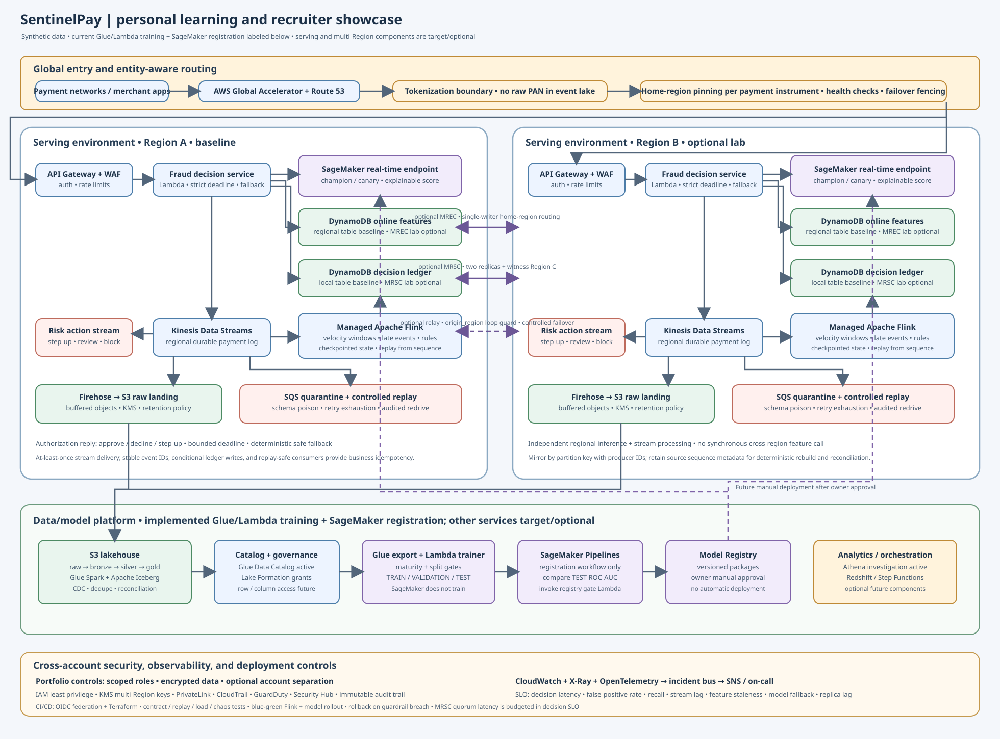

# SentinelPay — real-time financial fraud detection

> **Stage:** architecture and repository skeleton. Application, Terraform, and model implementation are intentionally not included yet. This README is the production-oriented build specification.

SentinelPay scores tokenized payment requests in the authorization path and keeps evaluating behavior asynchronously. It combines regional inference, stateful streaming features, replayable events, an auditable decision ledger, and governed model releases.

**Data boundary:** use synthetic/tokenized data only. Never store PAN, CVV, track data, credentials, or real customer data in source control, logs, fixtures, or the lake. This reference design is not a PCI DSS certification or production approval. Real use requires company security, privacy, legal, compliance, risk, and payment owners to approve the controls and policy. AWS describes PCI DSS responsibilities as shared in its [PCI DSS Security Reference Architecture](https://docs.aws.amazon.com/prescriptive-guidance/latest/aws-security-reference-architecture-pci-data-security-standard-dss/introduction.html).

## Architecture

Editable diagram: [Mermaid source](architecture/financial-fraud-architecture.mmd)

## Architecture intent

- **Two active serving Regions:** Global Accelerator and Route 53 steer tokenized requests to API Gateway/WAF and a regional decision service. The service reads local risk features, invokes a regional SageMaker endpoint, writes an idempotent decision, and returns approve/decline/step-up within an explicit deadline. Risk owners define fallback behavior and decision policy.
- **Stream path:** Kinesis Data Streams is the replayable payment event log. Managed Apache Flink computes event-time velocity windows, handles late records, evaluates streaming rules, and updates online features. Firehose lands raw events in S3. Invalid or poison events go to encrypted quarantine with audited redrive.
- **Online features:** DynamoDB Global Tables MREC hold versioned features. Each payment-instrument partition has one writer Region; failover fences that writer before promotion. A separate DynamoDB MRSC table is drawn for decision/idempotency keys when zero-RPO consistency is required. MRSC adds cross-Region write/read latency, requires exactly three Regions (two replicas plus a witness is supported), cannot span Region sets, and does not support TTL or transaction APIs. Benchmark it in the authorization path; if the cost/latency does not fit, assess an MREC ledger with an explicitly accepted RPO. Review [DynamoDB design guidance](https://docs.aws.amazon.com/amazondynamodb/latest/developerguide/bp-global-table-design.html) and the [deployment checklist](https://docs.aws.amazon.com/amazondynamodb/latest/developerguide/bp-global-table-design.prescriptive-guidance.checklist-and-faq.html) before choosing Regions.
- **Lakehouse:** S3 stores immutable source events and Iceberg bronze/silver/gold data. Glue Spark handles schema normalization, CDC, deduplication, reconciliation, and historical rebuilds. Glue Catalog and Lake Formation govern access. Athena is the default investigation query path; Redshift Serverless is optional.
- **ML lifecycle:** SageMaker Pipelines make point-in-time training data and evaluate temporal backtests, leakage, calibration, fairness, and drift. Model Registry approval gates champion/challenger canaries and rollback ([Model Registry docs](https://docs.aws.amazon.com/sagemaker/latest/dg/model-registry.html)).
- **Company controls:** separate PCI-serving, data-platform, and security/log-archive accounts; IAM least privilege; regional KMS keys; private service access; central audit logs; CloudWatch/X-Ray/OpenTelemetry; and CI/CD with short-lived OIDC identity. Final controls must match company policy.

Kinesis enhanced fan-out can isolate read capacity for multiple independent consumers. Select it from measured load and regional support ([AWS documentation](https://docs.aws.amazon.com/streams/latest/dev/enhanced-consumers.html)).

## Production build requirements

### Business policy and data correctness

- Define fraud classes, decision owners, permitted actions, step-up flow, review queue, chargeback outcomes, and appeals. Risk/compliance owners set targets for fraud loss, recall, false positives, customer friction, latency, and reviewer capacity.
- Define model-timeout, stale-feature, stream-lag, Region-failover, and dependency-outage fallbacks. Record model/policy version, reason codes, and rule hits for each decision.
- Versioned payment contract: stable event_id/idempotency key, schema version, tokenized payment/account IDs, merchant/device IDs, amount/currency, event and receive timestamps, source Region, trace ID. Define correction, deletion, retention, and delayed-label semantics.
- Assume at-least-once delivery: all consumers/sinks must be replay-safe and idempotent. Do not claim end-to-end exactly-once processing.
- Partition by a stable entity key; test hot-key skew. Specify event-time windows, watermarks, late-event handling, Flink state bounds, and replay horizon.
- Treat chargebacks as delayed labels and prevent future data leakage in historical training sets.
- Reconcile accepted/rejected/duplicate counts, decisions, checkpoints, and lake totals. A replay must reproduce business state with a traceable report.

### Availability and operations

- Set stage latency budgets for API, decision service, online reads, inference, idempotency write, and payment response. Measure p50/p95/p99 at normal, peak, burst, and degraded load.
- Define SLOs for availability, decision latency, feature freshness, stream lag, Flink checkpoints/backpressure, DynamoDB replication/throttles, DLQ age, and model fallback.
- Test Region evacuation, writer fencing, stale/duplicate input, throttling, KMS denial, model failure, partial account outage, and Flink checkpoint recovery.
- Set RTO/RPO per dataset and decision type. Preserve source sequence and raw events for rebuild/reconciliation. Define retention and legal-hold rules before S3 Object Lock.
- Runbooks: replay/redrive, Region evacuation, model rollback, stale features, key rotation, and evidence collection. Every alert has an owner, response policy, runbook, and tested delivery.

### Security and model governance

- Keep cardholder data out of scope where possible; tokenize at the boundary. Classify data and define token scope, access, retention, and deletion.
- Isolate accounts/VPCs; require TLS, KMS encryption, short-lived roles, least privilege, permission boundaries, and reviewed cross-account/resource policies.
- Centralize CloudTrail and protect audit integrity. Restrict logs, model artifacts, feature histories, and analyst access. Secrets belong in Secrets Manager/Parameter Store, never Git or Terraform state.
- Define Lake Formation row/column grants. Use synthetic CI fixtures. Threat-model ingress, tokenization, replay, model artifacts, CI identity, and cross-account trust; scan dependencies, images, and IaC.
- Use leakage-safe temporal splits and reproducible features. Measure business-selected precision/recall, calibration, segment error, and drift against rules-only and challenger baselines.
- Track data lineage, code/image and model digests, evaluation report, approver, deployment version, and rollback target. Promotion: offline evaluation → shadow → canary → wider rollout. Retraining must never auto-deploy.
- Implement fallback and stale-feature policy in the serving path, not only dashboards.

### Cost and capacity

Continuous active Regions, the MRSC witness, inference capacity, Flink, global tables, stream retention, audit logging, and analytics can be expensive. Set budgets/anomaly alerts before deployment. Start with small synthetic workloads, run scale tests in short windows, keep Redshift optional, and shut nonproduction capacity down after exercises. Estimate costs from region and measured throughput before sustained use.

## Repository layout

    .
    ├── readme.md
    ├── architecture/                 # this editable and rendered diagram
    ├── ci/                           # pipeline, policy checks, build metadata
    ├── data/
    │   ├── contracts/                # versioned schemas
    │   └── synthetic/                # generators and safe fixtures
    ├── docs/
    │   ├── adr/                      # architecture decisions
    │   ├── data-contracts/           # ownership, quality, retention
    │   └── runbooks/                 # recovery procedures
    ├── infra/terraform/modules/      # reusable account/Region modules
    ├── ml/
    │   ├── evaluation/               # leakage, calibration, fairness, drift
    │   └── pipelines/                # feature/train/register/deploy
    ├── ops/
    │   ├── alerts/
    │   ├── dashboards/
    │   └── runbooks/
    ├── scripts/                      # local and controlled replay tools
    ├── src/
    │   ├── decision-api/             # synchronous score and fallback
    │   ├── feature-pipeline/         # online feature contract/update
    │   ├── replay/                   # bounded audited redrive
    │   └── stream-processing/flink/  # velocity and streaming rules
    └── tests/
        ├── chaos/
        ├── contract/
        ├── integration/
        ├── load/
        └── unit/

Everything except this README and architecture files is a placeholder. Never commit credentials, account-specific state, real customer data, or Terraform state.

## Build order

1. **Requirements/ADRs:** decide risk policy, SLO, data class, retention, Region set, RTO/RPO, and MRSC-vs-MREC.
2. **Contracts/synthetic events:** implement payment, decision, feature, delayed-label schemas; generate skew, duplicates, late, malformed, and corrected events.
3. **Regional vertical slice:** tokenized ingress, bounded decisions, idempotency, Kinesis, Flink, quarantine, local replay.
4. **Lakehouse/ML:** immutable landing, Iceberg tables, reconciliation, point-in-time features, temporal evaluation, model registration.
5. **Security/CI:** account boundaries, Terraform state, OIDC, policy scanning, artifact provenance, isolated test environments.
6. **Second Region/witness:** add after first Region load results; verify MRSC region compatibility and recovery.
7. **Production exercises:** load, chaos, failover, delayed-label, replay, rollback, and incident drills; publish results/runbooks.

## Gates before any production claim

- Owners approve architecture, threat model, classification, and security/compliance review.
- No real cardholder data in portfolio assets, fixtures, logs, or screenshots.
- Contract, idempotency, late-event, correction, replay, reconciliation tests pass reproducibly.
- Load and failure tests meet agreed latency/error budgets.
- Region evacuation and writer fencing meet documented RTO/RPO.
- Model approval and rollback work end to end.
- An independent operator follows the runbooks successfully.
- Terraform plans, security scans, budgets, teardown, and recovery procedures are reviewed.

## AWS references

- [DynamoDB Global Tables design and consistency](https://docs.aws.amazon.com/amazondynamodb/latest/developerguide/bp-global-table-design.html)
- [DynamoDB Global Tables deployment checklist](https://docs.aws.amazon.com/amazondynamodb/latest/developerguide/bp-global-table-design.prescriptive-guidance.checklist-and-faq.html)
- [Kinesis enhanced fan-out](https://docs.aws.amazon.com/streams/latest/dev/enhanced-consumers.html)
- [Managed Service for Apache Flink](https://docs.aws.amazon.com/managed-flink/)
- [AWS Glue Iceberg support](https://docs.aws.amazon.com/glue/latest/dg/aws-glue-programming-etl-format-iceberg.html)
- [SageMaker Model Registry](https://docs.aws.amazon.com/sagemaker/latest/dg/model-registry.html)
- [AWS PCI DSS Security Reference Architecture](https://docs.aws.amazon.com/prescriptive-guidance/latest/aws-security-reference-architecture-pci-data-security-standard-dss/introduction.html)
